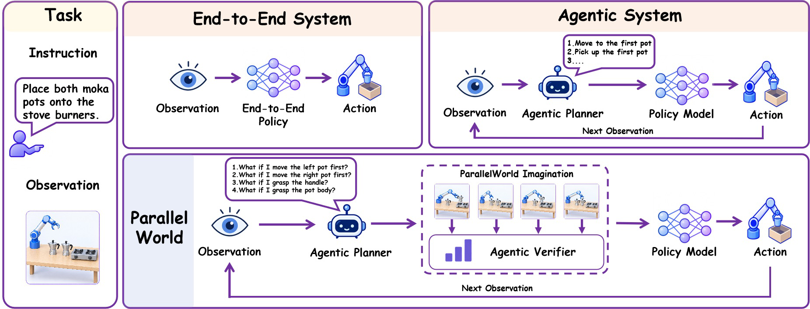
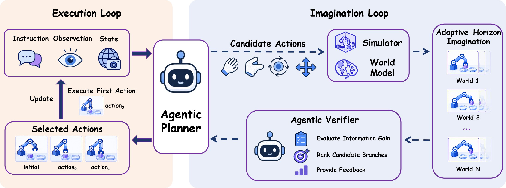

<div align="center">

# ParallelWorld

### Test-Time Scaling for Agentic Embodied Reasoning

[](https://arxiv.org/abs/2608.22971)
[](https://agenticei.github.io/ParallelWorld-page/)
[](LICENSE)

**Min Chen\*, Shengjun Zhang\*†, Yuxin Li, Zhang Zhang, Xin Fei, Chong Xia, Yueqi Duan**<br>
Tsinghua University · National University of Singapore<br>
\* Equal contribution · † Project leader

</div>



## Overview

ParallelWorld is an adaptive-horizon test-time scaling framework for agentic embodied reasoning. Instead of committing immediately to a locally plausible action, an agent uses ParallelWorld to imagine alternative action trajectories, compare their prospective outcomes, and select an interaction whose downstream consequences best support the task objective.

The framework combines verifier-guided tree search with receding-horizon execution. At every real environment step, the planner proposes candidate high-level actions and expands multiple prospective worlds in parallel. A verifier evaluates the resulting state transitions, retains promising branches, and guides subsequent expansion. The agent then executes only the first action of the selected trajectory and replans from the newly observed state.

This repository contains the two experimental instantiations presented in the paper:

- **Embodied understanding on ESI-Bench.** Simulator-based imagination explores alternative viewpoints and interactions to acquire task-relevant visual evidence.
- **Robotic manipulation on LIBERO-Pro.** An image world model predicts candidate action outcomes before the selected primitive is executed in the environment.

## Method



ParallelWorld alternates between an **imagination loop** and an **execution loop**:

1. **Imagine:** propose candidate actions and generate their prospective observations with a simulator or learned world model.
2. **Verify:** compare candidate branches against the task objective, prune weak trajectories, and decide whether further imagination is useful.
3. **Act and replan:** execute the first action of the selected trajectory, observe the resulting state, and start a new search.

## Repository structure

```text
parallelworld/
├── parallelworld_understanding/  # Spatial reasoning on ESI-Bench
├── parallelworld_manipulation/   # Robot manipulation on LIBERO-Pro
├── configs/                      # Evaluation settings and model profiles
├── docs/assets/                  # README figures
├── tools/                        # Validation and result aggregation
├── .env.example                  # API and resource configuration template
└── README.md
```

## Installation and evaluation

The two components use different simulators and should be installed in separate Python environments. Each component guide documents its dependencies, assets, checkpoints, configuration, evaluation commands, and metric calculation.

| Component | Benchmark | Documentation |
|---|---|---|
| `parallelworld_understanding` | ESI-Bench (OmniGibson / BEHAVIOR) | [Installation, data preparation, and evaluation](parallelworld_understanding/README.md) |
| `parallelworld_manipulation` | LIBERO-Pro (MuJoCo) | [Installation, checkpoints, and evaluation](parallelworld_manipulation/README.md) |

The understanding guide also documents the active and passive baselines and the retained dataset-generation tools. Run each launcher from the directory specified in its component guide.

## Model services and local configuration

After installing the selected component and downloading its external resources, configure the model services, datasets, and checkpoints. [`.env.example`](.env.example) provides a template:

```bash
export PARALLELWORLD_ROOT="$PWD"
cp .env.example .env
# Edit .env before loading it.
set -a
source .env
set +a
```

`OPENAI_API_KEY` and `OPENAI_BASE_URL` configure the reasoning service. LIBERO-Pro also uses an image-generation service; set `GPT_IMAGE_API_KEY` and `GPT_IMAGE_BASE_URL` when it uses different credentials or a different endpoint. The launchers read exported environment variables, and `.env` is excluded from version control.

## Validation

Run the static source and documentation checks with Python 3.10 or later:

```bash
python -m pip install -r requirements-dev.txt
python tools/check_package.py
```

This validation checks Python, Shell, TOML, and JSON syntax and verifies local README links. It does not start a simulator or send model inference requests.

## Citation

If you find ParallelWorld useful, please cite:

```bibtex
@misc{chen2026parallelworld,
  title         = {ParallelWorld: Test-Time Scaling for Agentic Embodied Reasoning},
  author        = {Min Chen and Shengjun Zhang and Yuxin Li and Zhang Zhang and Xin Fei and Chong Xia and Yueqi Duan},
  year          = {2026},
  eprint        = {2608.22971},
  archivePrefix = {arXiv},
  primaryClass  = {cs.AI},
  url           = {https://arxiv.org/abs/2608.22971}
}
```

## Acknowledgments

ParallelWorld builds on [ESI-Bench](https://github.com/ESI-Bench/ESI-Bench), [BEHAVIOR / OmniGibson](https://github.com/StanfordVL/BEHAVIOR-1K), [RPent](https://github.com/RLinf/RPent), [RLinf](https://github.com/RLinf/RLinf), and LIBERO-Pro. Their software, datasets, assets, and pretrained models remain subject to their respective licenses and terms.

## License

The ParallelWorld source code is released under the [Apache License 2.0](LICENSE). Third-party software, datasets, assets, and model weights are governed by their respective licenses.
